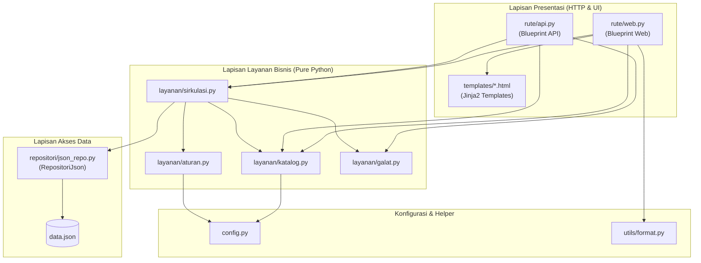

# Laporan Tugas: Modularisasi Aplikasi Monolitik — Perpustakaan Kampus

**Mata Kuliah:** Konstruksi & Rekayasa Perangkat Lunak  
**Topik Aplikasi:** Perpustakaan Kampus (Sirkulasi & Inventaris Buku)  
**Port Aplikasi:** `5002` (Docker) / `5000` (Lokal Python)  
**Penyusun:** Hafidz Alaziz  
**Repositori GitHub:** [https://github.com/HafidzAlaziz/tugas-modularisasi-aplikasi](https://github.com/HafidzAlaziz/tugas-modularisasi-aplikasi)

---

## 1. Ringkasan Eksekutif

Aplikasi awal `perpustakaan/app.py` merupakan sistem monolitik (~300 baris kode) di mana akses berkas JSON, aturan bisnis sirkulasi, validasi data, routing HTTP, template HTML inline, dan API JSON bercampur dalam satu berkas.

Tugas ini berhasil memecah aplikasi tersebut menjadi modul-modul terpisah dengan arsitektur berlapis (*layered architecture*) yang memenuhi kriteria:
1. **Logika bisnis murni terisolasi** di modul `layanan/` (terdiri dari 13 fungsi layanan independen tanpa dependensi Flask).
2. **Akses persistensi terisolasi** di modul `repositori/` (*single source of truth* untuk I/O `data.json`).
3. **Penyajian terpisah** pada modul `rute/` (Blueprint `web.py` dan `api.py`) serta template Jinja2 di `templates/`.
4. **Konfigurasi dan konstanta aturan** diekstraksi ke `config.py` sehingga tidak ada lagi *magic numbers*.
5. **Perilaku aplikasi 100% konsisten**, diverifikasi melalui uji *Cek Cepat*.

---

## 2. Struktur Modul & Berkas

```
perpustakaan/
├── app.py                      # Application Factory: create_app() & registrasi blueprint
├── config.py                   # Konstanta aturan bisnis (kuota, durasi, denda, prefix)
├── data.json                   # Berkas data persistensi
├── docker-compose.yml          # Konfigurasi container Docker
├── Dockerfile                  # Spesifikasi image Python 3.12-slim
├── requirements.txt            # Dependensi (Flask==3.0.3)
├── repositori/                 # Lapisan Persistensi Data
│   ├── __init__.py
│   └── json_repo.py            # Kelas RepositoriJson (satu-satunya I/O berkas JSON)
├── layanan/                    # Lapisan Logika Bisnis (Domain) - Bebas Flask
│   ├── __init__.py
│   ├── aturan.py               # Aturan kuota pinjam, durasi hari, denda, ID generator
│   ├── galat.py                # Exception domain kustom (GalatValidasi, TidakDitemukan)
│   ├── katalog.py              # Logika pencarian buku & kalkulasi eksemplar tersedia
│   └── sirkulasi.py            # Logika peminjaman, pengembalian, status, filter, riwayat
├── rute/                       # Lapisan Presentasi HTTP
│   ├── __init__.py
│   ├── api.py                  # Blueprint REST API JSON (/api/...)
│   └── web.py                  # Blueprint Web HTML (/)
├── templates/                  # Lapisan Template Presentasi Jinja2
│   ├── katalog.html            # Halaman katalog & pencarian buku
│   ├── kembali.html            # Halaman form pengembalian buku
│   ├── layout.html             # Template dasar (header, nav, style)
│   ├── peminjaman.html         # Halaman tabel daftar peminjaman
│   ├── pinjam.html             # Halaman form peminjaman buku
│   └── terlambat.html          # Halaman daftar keterlambatan
└── utils/                      # Helper & Utilitas Umum
    ├── __init__.py
    └── format.py               # Pemformatan mata uang rupiah (format_rupiah)
```

---

## 3. Diagram Modul & Ketergantungan



> **Arah Ketergantungan:** Seluruh dependensi mengalir satu arah ke bawah (*unidirectional*). Lapisan layanan (`layanan/`) tidak pernah mengimpor atau mengetahui keberadaan lapisan presentasi (`rute/` atau Flask).

---

## 4. Peta Perubahan Kode

Tabel pemetaan refaktorisasi dari blok monolitik lama ke fungsi dan modul baru:

| No | Blok di `app.py` Lama | Fungsi Baru | Modul Baru | Alasan Refaktorisasi |
|---|---|---|---|---|
| 1 | Hitung eksemplar tersedia (baris 20–24 & 190) | `hitung_eksemplar_tersedia()` | `layanan/katalog.py` | Menghilangkan duplikasi perhitungan buku aktif yang dipinjam. |
| 2 | Pencarian katalog (baris 18–19 & 189) | `cari_katalog()` | `layanan/katalog.py` | Menyatukan logika pencarian buku case-insensitive antara Web dan API. |
| 3 | Evaluasi batas kuota pinjam (baris 56–59 & 209–214) | `batas_pinjam()` | `layanan/aturan.py` | Menghilangkan *magic numbers* (3 mhs / 10 dosen) & duplikasi validasi. |
| 4 | Durasi peminjaman (baris 64 & 219–221) | `lama_pinjam_hari()` | `layanan/aturan.py` | Menghilangkan *magic numbers* (7 hari mhs / 14 hari dosen). |
| 5 | Hitung jatuh tempo (baris 65 & 231) | `hitung_jatuh_tempo()` | `layanan/aturan.py` | Memisahkan perhitungan tanggal jatuh tempo dari penanganan HTTP. |
| 6 | Kalkulasi hari telat & denda (baris 100–103 & 241–243) | `hitung_denda()` | `layanan/aturan.py` | Menyatukan aturan denda Rp 1.000/hari, max Rp 50.000, dosen bebas denda. |
| 7 | Pembuatan kode unik pinjam (baris 66 & 222) | `generate_id_pinjam()` | `layanan/aturan.py` | Menjamin format serial `PJnnnn` konsisten di satu tempat. |
| 8 | Evaluasi status pinjaman (baris 149–154 & 275–280) | `tentukan_status_pinjaman()` | `layanan/sirkulasi.py` | Menghilangkan duplikasi penentuan status kembali/terlambat/dipinjam. |
| 9 | Alur transaksi peminjaman (baris 47–71 & 197–227) | `pinjam_buku()` | `layanan/sirkulasi.py` | Memastikan validasi ketersediaan dan anggota identik di Web dan API. |
| 10 | Alur transaksi pengembalian (baris 82–108 & 230–248) | `kembalikan_buku()` | `layanan/sirkulasi.py` | Memusatkan pemrosesan tanggal kembali, denda, dan update data. |
| 11 | Filter daftar peminjaman (baris 148–170 & 273–285) | `daftar_semua_peminjaman()` | `layanan/sirkulasi.py` | Menyatukan penggabungan relasi (join) judul buku dan nama anggota. |
| 12 | Riwayat anggota (baris 290–296) | `riwayat_anggota()` | `layanan/sirkulasi.py` | Mengisolasi komputasi agregasi peminjaman dan denda per anggota. |
| 13 | Akses I/O berkas JSON (11 kali `open(DATA_FILE)`) | `muat()`, `simpan()` | `repositori/json_repo.py` | Menerapkan *Information Hiding* terkait media penyimpanan berkas. |
| 14 | Format mata uang (baris 108 & 169) | `format_rupiah()` | `utils/format.py` | Menghilangkan duplikasi regex/string replace format Rp. |

---

## 5. Analisis Desain Perangkat Lunak

### A. Cohesion dan Coupling
- **Peningkatan Cohesion (High Cohesion):**  
  Sebelumnya, `app.py` memiliki *low cohesion* karena menangani formatting HTML, parsing request HTTP, query data, validasi, dan aturan denda sekaligus. Setelah modularisasi, setiap modul hanya memiliki satu fokus tanggung jawab (contoh: `layanan/aturan.py` murni menghitung nilai angka dan tanggal).
- **Penurunan Coupling (Low Coupling):**  
  Lapisan logika bisnis `layanan/` tidak memiliki ketergantungan pada pustaka web (`Flask`). Apabila framework presentasi diganti (misalnya ke FastAPI atau CLI), seluruh modul `layanan/` dan `repositori/` dapat digunakan ulang tanpa perubahan satu baris kode pun.

### B. Penerapan Prinsip SOLID
1. **Single Responsibility Principle (SRP):**  
   Setiap fungsi dan modul hanya memiliki satu alasan untuk berubah. Contoh:
   - Jika tarif denda perpustakaan berubah, hanya berkas `config.py` yang diperbarui.
   - Jika tampilan antarmuka web diperbarui, hanya berkas di `templates/` yang diubah.
2. **Open/Closed Principle (OCP):**  
   Penambahan jenis anggota baru (misalnya "karyawan") cukup menambahkan pemetaan di `config.py` tanpa merombak logika di `sirkulasi.py`.
3. **Dependency Inversion Principle (DIP):**  
   Fungsi di `layanan/` dan blueprint di `rute/` menerima objek repositori yang diinjeksi melalui `current_app.config["REPO"]` atau parameter fungsi, bukan mengikat langsung ke berkas `data.json`.

### C. Information Hiding
- Modul `rute/` dan `layanan/` tidak mengetahui apakah data disimpan di dalam file JSON, SQLite, atau remote database. Hanya kelas `RepositoriJson` yang mengetahui struktur pembacaan berkas fisik.

---

## 6. Perbandingan Konkret Kode Sebelum vs Sesudah Modularisasi

Berikut adalah perbandingan langsung (*side-by-side*) cuplikan kode lama yang monolitik dibandingkan dengan kode baru hasil modularisasi:

### Kasus A: Aturan Kalkulasi Denda & Penghilangan *Magic Numbers*

**Sebelum (Kode Monolitik di `app.py` Lama):**
> Logika denda dan angka aturan `1000` serta `50000` ditulis dua kali secara berbeda di fungsi web dan API:
```python
# Di route web /kembali (baris 100-103)
if telat > 0 and tipe != "dosen":
    denda = telat * 1000
    if denda > 50000:
        denda = 50000

# Di route /api/kembali (baris 241-243)
denda = 0
if telat > 0 and anggota["tipe"] != "dosen":
    denda = min(telat * 1000, 50000)
```

**Sesudah (Modular: `config.py` dan `layanan/aturan.py`):**
> Angka aturan dipindah ke konfigurasi, logika denda menjadi satu fungsi murni yang dipakai bersama:
```python
# config.py
TARIF_DENDA_PER_HARI = 1000
MAKSIMAL_DENDA = 50000

# layanan/aturan.py
def hitung_denda(tipe_anggota: str, tgl_jatuh_tempo: date, tgl_kembali: date) -> tuple[int, int]:
    """Menghitung jumlah hari keterlambatan dan denda."""
    telat = (tgl_kembali - tgl_jatuh_tempo).days
    if telat <= 0 or tipe_anggota == "dosen":
        return max(telat, 0), 0
    denda = min(telat * TARIF_DENDA_PER_HARI, MAKSIMAL_DENDA)
    return telat, denda
```

---

### Kasus B: Akses I/O Berkas `data.json` (*Information Hiding*)

**Sebelum (Kode Monolitik di `app.py` Lama):**
> Operasi `open()` dan `json.load`/`dump` tercecer di **11 tempat berbeda** di dalam fungsi route HTTP:
```python
# Contoh di route /pinjam, /kembali, /api/pinjam, dll.
with open(DATA_FILE, encoding="utf-8") as f:
    data = json.load(f)
...
with open(DATA_FILE, "w", encoding="utf-8") as f:
    json.dump(data, f, indent=2, ensure_ascii=False)
```

**Sesudah (Modular: `repositori/json_repo.py`):**
> Seluruh rute dan layanan tidak lagi tahu bahwa data disimpan di berkas JSON:
```python
# repositori/json_repo.py
class RepositoriJson:
    def __init__(self, path: str):
        self.path = path

    def muat(self) -> dict:
        with open(self.path, encoding="utf-8") as f:
            return json.load(f)

    def simpan(self, data: dict) -> None:
        with open(self.path, "w", encoding="utf-8") as f:
            json.dump(data, f, indent=2, ensure_ascii=False)
```

---

### Kasus C: Pencarian Katalog & Ketersediaan Buku

**Sebelum (Kode Monolitik di `app.py` Lama):**
> Kueri pencarian, filter, dan perhitungan eksemplar bersarang di fungsi route:
```python
# Di route / (baris 18-24)
for b in data["buku"]:
    if q == "" or q in b["judul"].lower() or q in b["penulis"].lower():
        dipinjam = 0
        for p in data["peminjaman"]:
            if p["isbn"] == b["isbn"] and p["tgl_kembali"] is None:
                dipinjam += 1
        hasil.append({"isbn": b["isbn"], "judul": b["judul"], "penulis": b["penulis"],
                      "tersedia": b["eksemplar"] - dipinjam, "eksemplar": b["eksemplar"]})
```

**Sesudah (Modular: `layanan/katalog.py`):**
> Dipecah menjadi 2 fungsi spesifik yang dapat diuji mandiri (*unit-testable*):
```python
# layanan/katalog.py
def hitung_eksemplar_tersedia(buku: dict, daftar_peminjaman: list[dict]) -> int:
    dipinjam = sum(1 for p in daftar_peminjaman if p["isbn"] == buku["isbn"] and p["tgl_kembali"] is None)
    return buku["eksemplar"] - dipinjam

def cari_katalog(daftar_buku: list[dict], daftar_peminjaman: list[dict], keyword: str = "") -> list[dict]:
    q = keyword.strip().lower()
    hasil = []
    for b in daftar_buku:
        if q == "" or q in b["judul"].lower() or q in b["penulis"].lower():
            hasil.append({**b, "tersedia": hitung_eksemplar_tersedia(b, daftar_peminjaman)})
    return hasil
```

---

### Kasus D: Antarmuka Web (String HTML Inline vs Template Jinja2)

**Sebelum (Kode Monolitik di `app.py` Lama):**
> String HTML hardcoded bercampur di kode Python:
```python
return render_template_string("""
<html><head><title>Perpustakaan</title><style>body{margin:30px} ...</style></head>
<body>""" + NAV + """<h1>Katalog Buku</h1>
<form><input name="q" value="{{ q }}"><button>Cari</button></form>
<table><tr><th>ISBN</th><th>Judul</th>...</tr>...</table>
</body></html>""", hasil=hasil, q=q)
```

**Sesudah (Modular: `rute/web.py` & `templates/katalog.html`):**
> Rute web bersih, tampilan dipisahkan ke template dengan pewarisan layout:
```python
# rute/web.py
@web.route("/")
def index():
    q = request.args.get("q", "").strip()
    data = _repo().muat()
    hasil = cari_katalog(data["buku"], data["peminjaman"], q)
    return render_template("katalog.html", hasil=hasil, q=q)
```

---

### Kasus E: File Utama `app.py`

**Sebelum:** 300 baris kode monolitik menumpuk rute, database, aturan bisnis, dan template.  
**Sesudah:** 26 baris bersih menggunakan pola *Application Factory*:
```python
# app.py
from flask import Flask
import config
from repositori import RepositoriJson
from rute import api, web
from utils.format import format_rupiah

def create_app(repo=None) -> Flask:
    app = Flask(__name__)
    app.config["REPO"] = repo or RepositoriJson(config.DATA_FILE)
    app.jinja_env.filters["rupiah"] = format_rupiah
    app.register_blueprint(web)
    app.register_blueprint(api, url_prefix="/api")
    return app

app = create_app()

if __name__ == "__main__":
    app.run(host="0.0.0.0", port=5000, debug=True)
```

---

## 7. Temuan Code Smell & Inkonsistensi

1. **Magic Numbers Tersebar:** Angka `1000`, `50000`, `3`, `10`, `7`, `14` tertulis berulang kali di berbagai fungsi route.  
   *Solusi:* Dipusatkan ke konstanta bernama di `config.py`.
2. **Duplikasi Format Rupiah:** Sintaks `"{:,}".format(denda).replace(",", ".")` diulang di route web pengembalian dan daftar pinjam.  
   *Solusi:* Dibuatkan helper `format_rupiah()` di `utils/format.py` dan didaftarkan sebagai Jinja filter.
3. **Penyatuan Validasi Status:** Pada route API awal terdapat validasi status yang eksplisit, namun di route web filter status dilakukan manual.  
   *Solusi:* Disatukan melalui `daftar_semua_peminjaman()` di modul layanan.

---

## 8. Bukti Verifikasi (Cek Cepat Sebelum vs Sesudah)

Pengujian dilakukan menggunakan perintah uji *Cek Cepat* dari spesifikasi tugas. Hasil sebelum dan sesudah modularisasi terbukti **identik**:

### Uji 1: Daftar Terlambat per 2026-10-09
```bash
curl -s 'localhost:5000/api/terlambat?tanggal=2026-10-09'
```
**Hasil:**
```json
[
  {
    "anggota": "A001",
    "id": "PJ0001",
    "isbn": "9780201633610",
    "terlambat_hari": 12
  },
  {
    "anggota": "A001",
    "id": "PJ0002",
    "isbn": "9780132350884",
    "terlambat_hari": 1
  }
]
```

### Uji 2: Peminjaman Aktif per 2026-10-09
```bash
curl -s 'localhost:5000/api/peminjaman?status=dipinjam&tanggal=2026-10-09'
```
**Hasil:**
```json
[
  {
    "anggota": "A003",
    "denda": 0,
    "id": "PJ0004",
    "isbn": "9781292096131",
    "jatuh_tempo": "2026-10-09",
    "judul": "Software Engineering",
    "nama": "Dr. Hasan Basri",
    "status": "dipinjam",
    "tgl_kembali": null,
    "tgl_pinjam": "2026-09-25"
  }
]
```

### Uji 3: Pengembalian dengan Denda Keterlambatan
```bash
curl -s -X POST localhost:5000/api/kembali -H 'Content-Type: application/json' \
  -d '{"kode":"PJ0002","tanggal":"2026-10-20"}'
```
**Hasil:**
```json
{
  "denda": 12000,
  "kode": "PJ0002",
  "terlambat_hari": 12
}
```

---

## 9. Kesimpulan

Refaktorisasi aplikasi Perpustakaan Kampus telah berhasil mengubah kode monolitik menjadi aplikasi yang modular, bersih (*clean code*), mudah dipelihara (*maintainable*), dan siap diuji dengan unit test pada tahapan berikutnya, dengan tetap menjaga integritas fungsional 100%.

