# Perpustakaan Kampus (Versi Modular)

**Tipe aplikasi:** Sirkulasi / manajemen inventaris · **Port:** http://localhost:5002 (Docker) / http://localhost:5000 (Lokal)

Sirkulasi buku perpustakaan: katalog, peminjaman, pengembalian dengan denda, daftar keterlambatan.

> ✅ Aplikasi ini telah **dimodularisasi** dari versi monolitik menjadi arsitektur berlapis (*layered architecture*) yang memisahkan lapisan presentasi (rute & templates), aturan bisnis (layanan), konfigurasi (config), dan persistensi data (repositori). Laporan lengkap desain dan pemetaan fungsi: [`../LAPORAN.md`](../LAPORAN.md).

---

## Struktur Proyek

```
perpustakaan/
├── app.py                      # Application Factory: create_app() & registrasi blueprint
├── config.py                   # Konstanta aturan bisnis (kuota, durasi, denda, prefix)
├── data.json                   # Data persistensi (JSON)
├── docker-compose.yml          # Konfigurasi Docker Compose (port 5002)
├── Dockerfile                  # Image Python 3.12-slim
├── requirements.txt            # Flask==3.0.3
├── repositori/                 # Satu-satunya modul yang membaca/menulis data.json
│   ├── __init__.py
│   └── json_repo.py            # Kelas RepositoriJson
├── layanan/                    # Aturan bisnis murni (bebas Flask / request / HTML)
│   ├── __init__.py
│   ├── aturan.py               # Batas pinjam, durasi hari, denda, kode PJnnnn
│   ├── galat.py                # Exception kustom domain (GalatValidasi, TidakDitemukan)
│   ├── katalog.py              # Pencarian buku & eksemplar tersedia
│   └── sirkulasi.py            # Peminjaman, pengembalian, status, riwayat
├── rute/                       # Blueprint rute HTTP
│   ├── __init__.py
│   ├── api.py                  # Endpoint JSON (/api/...)
│   └── web.py                  # Endpoint halaman HTML
├── templates/                  # Template HTML Jinja2
│   ├── katalog.html
│   ├── kembali.html
│   ├── layout.html
│   ├── peminjaman.html
│   ├── pinjam.html
│   └── terlambat.html
└── utils/
    ├── __init__.py
    └── format.py               # Helper format rupiah (format_rupiah)
```

---

## Alur Kerja Program (Flowchart)

Diagram di bawah memakai bahasa sehari-hari supaya mudah dipahami. Semuanya ditulis dengan Mermaid, jadi tampil otomatis di GitHub.

### Gambaran Besar

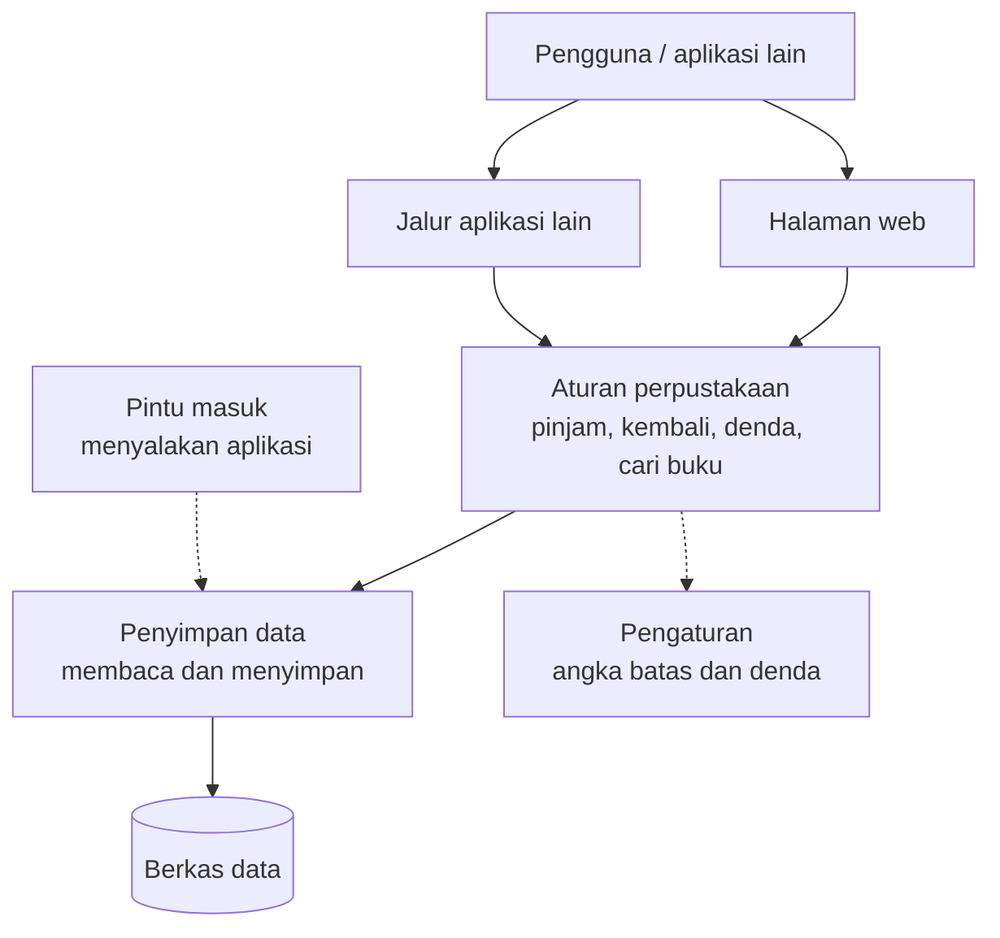

| Istilah di diagram | Lokasi di proyek |
|--------------------|------------------|
| Halaman web | `rute/web.py` dan `templates/` |
| Jalur aplikasi lain | `rute/api.py` |
| Aturan perpustakaan | `layanan/` |
| Penyimpan data | `repositori/json_repo.py` |
| Pengaturan | `config.py` |
| Pintu masuk | `app.py` |
| Berkas data | `data.json` |

### 1. Meminjam Buku

Ada 4 pemeriksaan berurutan. Kalau salah satu gagal, peminjaman ditolak.

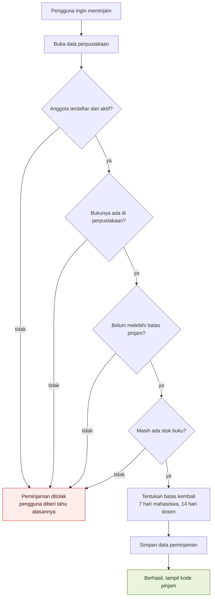

### 2. Mengembalikan Buku

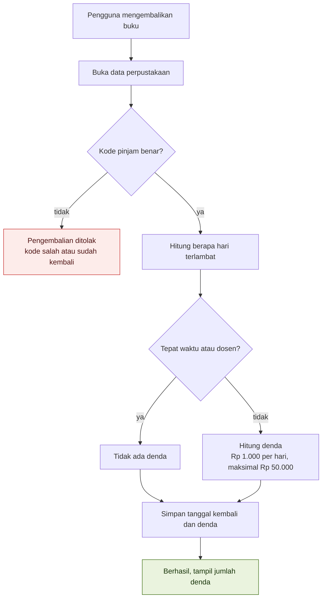

### 3. Batas Pinjam dan Lama Pinjam

Jumlah buku dan lama pinjam tergantung siapa yang meminjam.

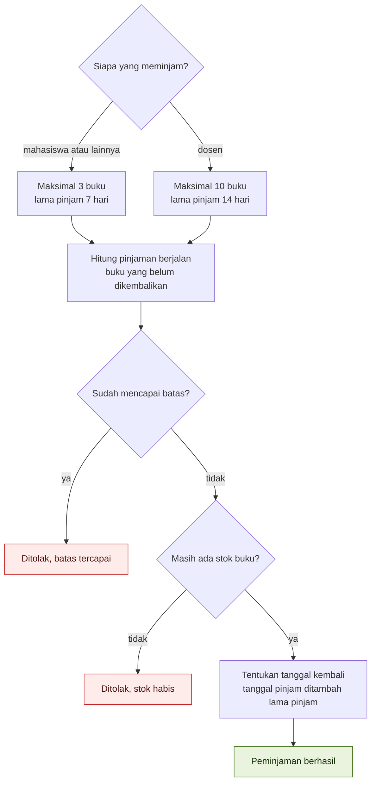

### 4. Histori Peminjaman

Melihat daftar semua peminjaman, bisa disaring berdasarkan status dan anggota.

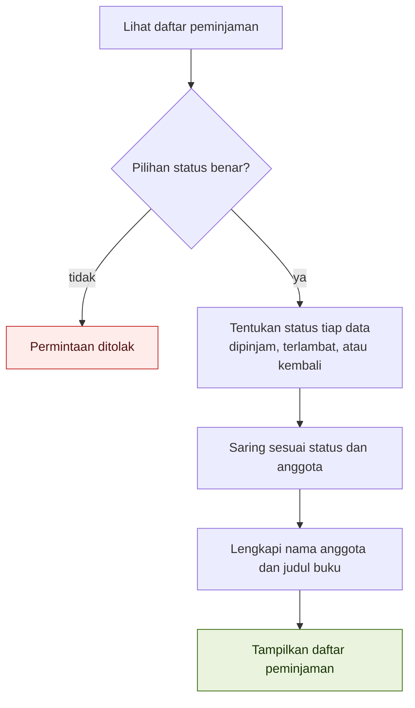

### 5. Riwayat Satu Anggota

Fitur ini hanya tersedia lewat jalur aplikasi lain (`/api/anggota/<id>/riwayat`), tidak ada halaman web-nya.

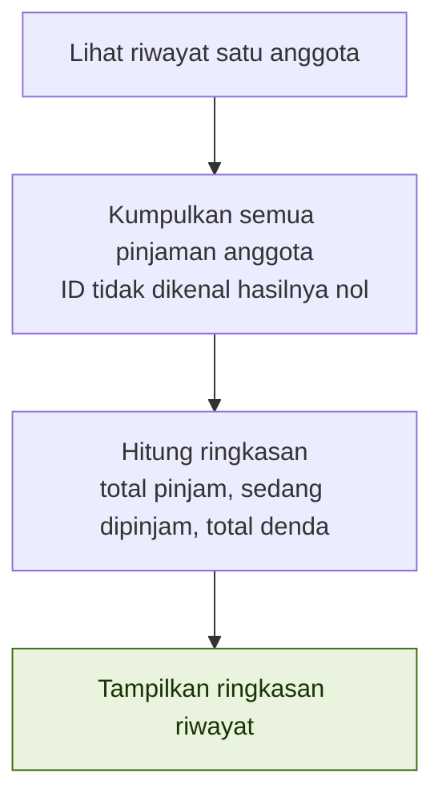

### 6. Cari Buku di Katalog

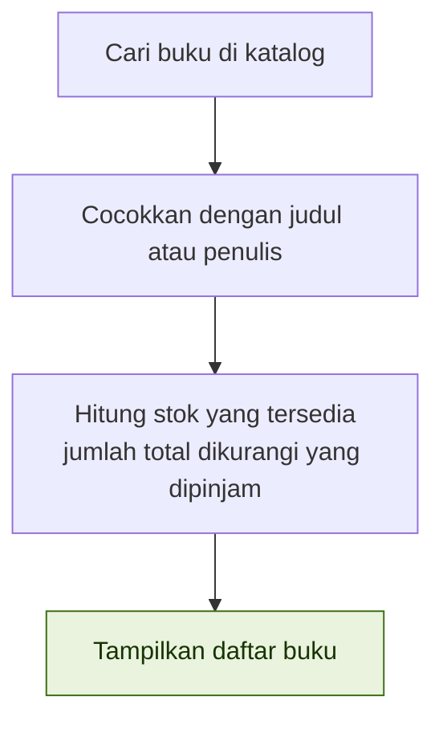

### 7. Daftar Terlambat

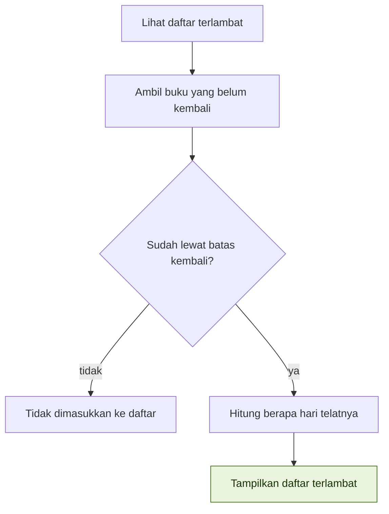

---

## Cara Menjalankan

### Dengan Docker
```bash
docker compose up --build
# buka http://localhost:5002
```

### Tanpa Docker (Python Lokal)
```bash
python -m venv .venv
source .venv/bin/activate    # Di Linux / Mac
# atau .venv\Scripts\activate di Windows
pip install -r requirements.txt
python app.py
# buka http://localhost:5000
```

---

## Cek Cepat Verifikasi

Perintah pengujian berikut memberikan hasil yang sama persis antara sebelum dan sesudah modularisasi:

```bash
# 1. Cek keterlambatan
curl -s 'localhost:5000/api/terlambat?tanggal=2026-10-09'
# Hasil: PJ0001 terlambat 12 hari, PJ0002 terlambat 1 hari

# 2. Cek peminjaman aktif
curl -s 'localhost:5000/api/peminjaman?status=dipinjam&tanggal=2026-10-09'
# Hasil: PJ0004, Dr. Hasan Basri, Software Engineering, status dipinjam

# 3. Cek kembali & denda
curl -s -X POST localhost:5000/api/kembali -H 'Content-Type: application/json' \
  -d '{"kode":"PJ0002","tanggal":"2026-10-20"}'
# Hasil: terlambat_hari 12, denda 12000
```

*Catatan: Kembalikan data ke awal setelah pengujian dengan `git checkout -- data.json`.*

---

## Aturan Bisnis yang Dimodularisasi

1. **Pencarian buku:** Berdasarkan judul atau penulis (*case-insensitive*) di `layanan/katalog.py`.
2. **Eksemplar tersedia:** `eksemplar - buku yang sedang dipinjam` di `layanan/katalog.py`.
3. **Validasi anggota:** Hanya anggota aktif yang boleh meminjam di `layanan/sirkulasi.py`.
4. **Batas pinjam:** Mahasiswa 3 buku, Dosen 10 buku di `config.py` dan `layanan/aturan.py`.
5. **Lama pinjam:** Mahasiswa 7 hari, Dosen 14 hari di `config.py` dan `layanan/aturan.py`.
6. **Denda keterlambatan:** Rp 1.000/hari, maksimal Rp 50.000, dosen bebas denda di `layanan/aturan.py`.
7. **Kode peminjaman:** Format otomatis `PJnnnn` di `layanan/aturan.py`.
8. **Status peminjaman:** `kembali`, `terlambat`, atau `dipinjam` di `layanan/sirkulasi.py`.
9. **Riwayat anggota:** Jumlah pinjam, sedang dipinjam, dan total denda di `layanan/sirkulasi.py`.

---

## Pengujian Perangkat Lunak (Unit Test & Integration Test)

Pengujian dibagi menjadi dua jenis sesuai arsitektur modular:

| File Test | Jenis Pengujian | Target Modul yang Diuji | Cakupan Pengujian |
|---|---|---|---|
| `tests/test_aturan.py` | **Unit Test** | `layanan/aturan.py`, `utils/format.py` | Kuota pinjam, durasi hari, jatuh tempo, kalkulasi denda, format kode `PJnnnn`, format rupiah |
| `tests/test_katalog.py` | **Unit Test** | `layanan/katalog.py` | Hitung stok eksemplar tersedia & pencarian buku (*case-insensitive*) |
| `tests/test_peminjaman.py` | **Integration Test** | `layanan/sirkulasi.py` + DB JSON | Alur peminjaman buku: kondisi sukses vs kondisi galat (anggota nonaktif, buku tidak ada, stok habis, kuota limit) |
| `tests/test_pengembalian.py` | **Integration Test** | `layanan/sirkulasi.py` + DB JSON | Alur pengembalian buku: tepat waktu, telat denda mahasiswa, bebas denda dosen, kode salah, dan daftar keterlambatan |

> **Catatan Isolasi Database:** Integration test menggunakan database tiruan (`test_data_pinjam.json` & `test_data_kembali.json`) yang dibuat pada `setUp` dan dihapus pada `tearDown`, sehingga data produksi di `data.json` tetap aman dan tidak tercemar.

---

### 1. Unit Test — Aturan Sirkulasi & Format (`tests/test_aturan.py`)

Menguji fungsi kalkulasi bisnis murni secara terisolasi tanpa akses database atau Flask.

```bash
python3 -m unittest tests.test_aturan -v
```

**Hasil Eksekusi Test:**

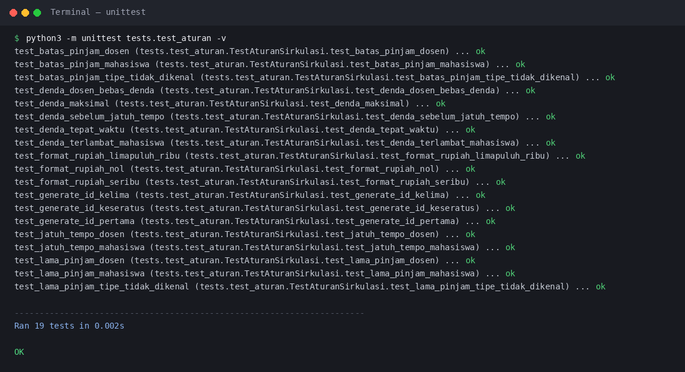

---

### 2. Unit Test — Katalog & Eksemplar Buku (`tests/test_katalog.py`)

Menguji logika pencarian buku berdasarkan judul/penulis serta kalkulasi sisa eksemplar fisik yang tersedia.

```bash
python3 -m unittest tests.test_katalog -v
```

**Hasil Eksekusi Test:**

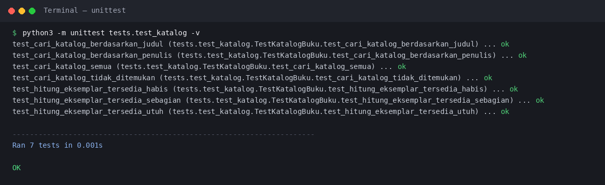

---

### 3. Integration Test — Alur Peminjaman Buku (`tests/test_peminjaman.py`)

Menguji alur peminjaman buku yang mengintegrasikan validasi anggota, stok katalog, penomoran kode transaksi, dan penyimpanan ke file database JSON.

- **Kondisi Input Benar:** Mahasiswa aktif (+7 hari), Dosen aktif (+14 hari).
- **Kondisi Input Salah:** Anggota nonaktif, ID anggota tidak ada, ISBN tidak ada, stok eksemplar habis, kuota 3 buku terlampaui.

```bash
python3 -m unittest tests.test_peminjaman -v
```

**Hasil Eksekusi Test:**

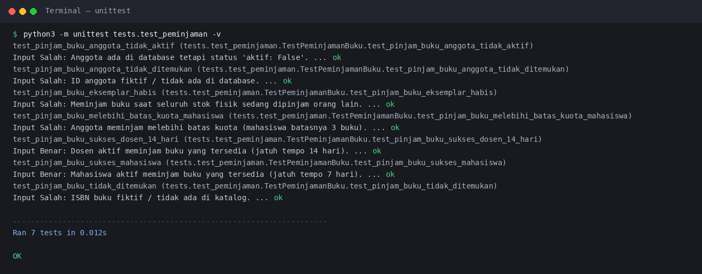

---

### 4. Integration Test — Alur Pengembalian & Denda (`tests/test_pengembalian.py`)

Menguji alur pengembalian buku, kalkulasi denda keterlambatan, pembebasan denda untuk dosen, dan query daftar keterlambatan.

- **Kondisi Input Benar:** Tepat waktu (denda Rp 0), mahasiswa telat (Rp 1.000/hari), dosen telat (Rp 0), daftar telat valid.
- **Kondisi Input Salah:** Kode transaksi tidak ada, kode transaksi sudah pernah dikembalikan sebelumnya, filter status tidak dikenal.

```bash
python3 -m unittest tests.test_pengembalian -v
```

**Hasil Eksekusi Test:**

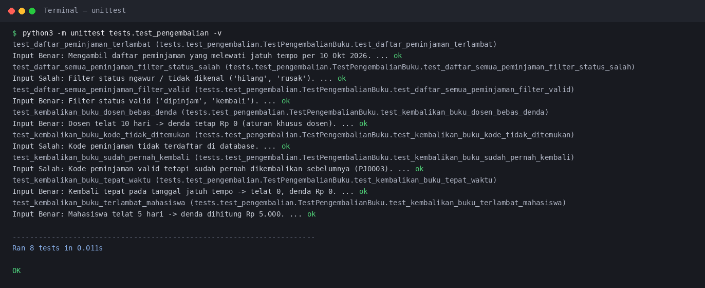

---

### 5. Menjalankan Seluruh Test Sekaligus (Test Suite Discovery)

Menjalankan seluruh pengujian unit test dan integration test secara otomatis (total 41 pengujian).

```bash
python3 -m unittest discover -s tests -t . -v
```

**Hasil Eksekusi Test Keseluruhan (41/41 Lulus):**

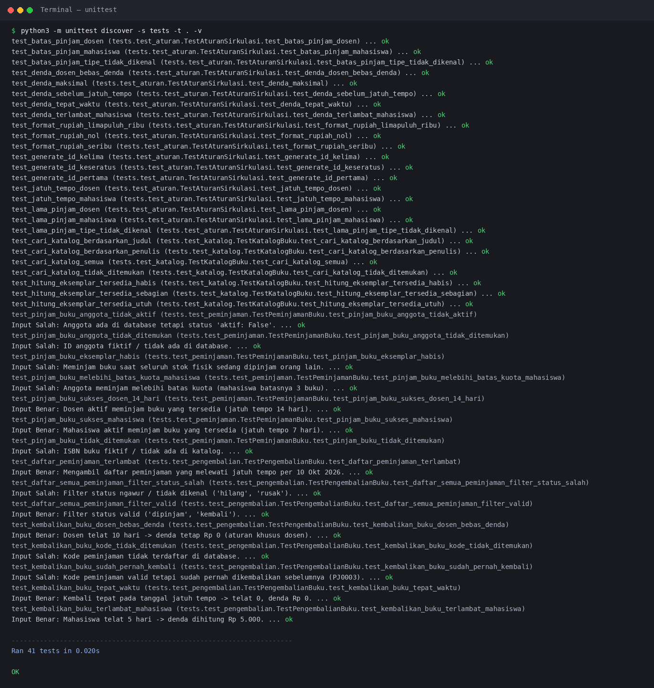

---

## Cara Membuat Test Gagal (Simulasi Deteksi Bug)

Untuk mendemonstrasikan bagaimana automated testing mendeteksi bug atau regresi kode, baik pada level **Unit Test** maupun **Integration Test**:

### Simulasi 1 — Bug pada Unit Test (`tests/test_aturan.py`)

Ubah sementara konfigurasi aturan tarif denda per hari di `config.py` dari `1000` menjadi `2000`:

```python
# config.py (sebelum)
TARIF_DENDA_PER_HARI = 1000

# config.py (sesudah - simulasi bug)
TARIF_DENDA_PER_HARI = 2000
```

Jalankan Unit Test:
```bash
python3 -m unittest tests.test_aturan -v
```

**Hasil Eksekusi Unit Test Mendeteksi Bug (`FAIL`):**

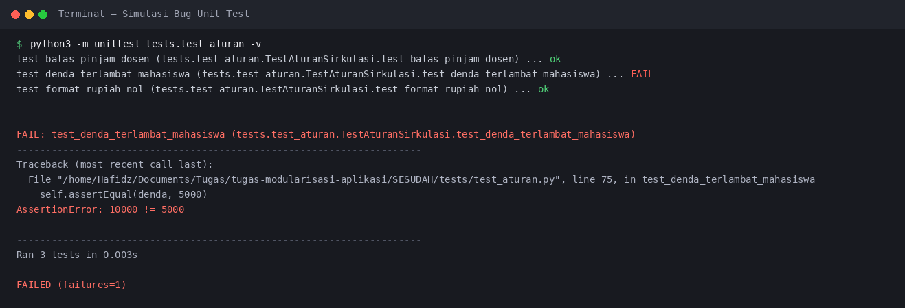

> **Analisis:** Method `test_denda_terlambat_mahasiswa` mendeteksi bahwa denda keterlambatan 5 hari menghasilkan nilai `Rp 10.000`, padahal kunci jawaban/ekspektasi spesifikasi adalah `Rp 5.000` (`AssertionError: 10000 != 5000`). Test otomatis langsung berstatus `FAIL`.

---

### Simulasi 2 — Bug pada Integration Test (`tests/test_peminjaman.py`)

Hapus atau beri komentar sementara pada baris validasi status keaktifan anggota di `layanan/sirkulasi.py`:

```python
# layanan/sirkulasi.py (simulasi bug - validasi anggota dimatikan)
# if anggota is None or not anggota.get("aktif", False):
#     raise GalatValidasi("Anggota tidak ditemukan atau tidak aktif")
```

Jalankan Integration Test:
```bash
python3 -m unittest tests.test_peminjaman -v
```

**Hasil Eksekusi Integration Test Mendeteksi Bug (`FAIL`):**

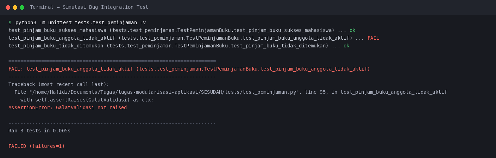

> **Analisis:** Method `test_pinjam_buku_anggota_tidak_aktif` mengharapkan sistem melempar galat penolakan `GalatValidasi`. Karena validasi dimatikan, sistem meloloskan peminjaman anggota nonaktif, sehingga test gagal dengan pesan `AssertionError: GalatValidasi not raised`.


